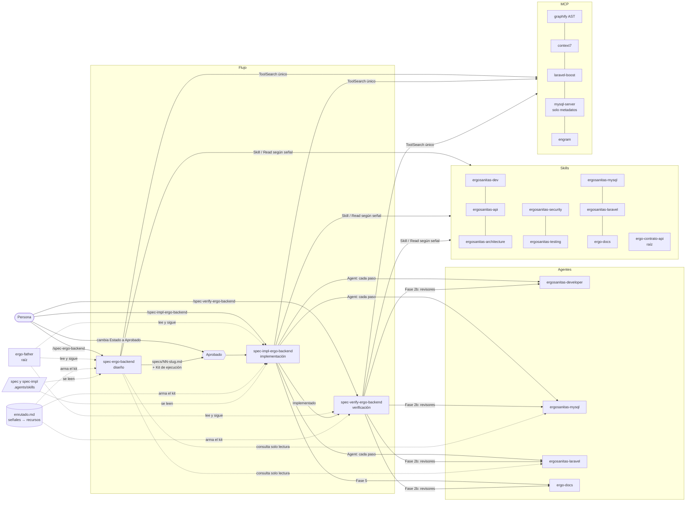

# Enrutado de una spec del back — el «Kit de ejecución»

Fuente **única** que usan `spec-ergo-backend` (diseño), `spec-impl-ergo-backend`
(implementación), `spec-verify-ergo-backend` (verificación) y sus tres agentes homónimos.
Dice, a partir de lo que toca una spec, **qué skills se cargan, qué agentes se lanzan y qué MCP
se usan en cada fase**. Nadie elige recursos «a ojo»: se detectan las señales, se arma el kit, se
muestra y se ejecuta.

Si algo de aquí contradice `CLAUDE.md`, manda `CLAUDE.md`.

---

## 1. Cómo se arma el kit (los tres pasos, en cualquier fase)

1. **Detectar señales** (§2) en la fuente que haya:
   - diseño → la descripción del requerimiento + `graphify query "<feature>"` sobre el dominio vecino;
   - implementación → la spec (contrato, plan, archivos citados) + su sección «Kit de ejecución»;
   - verificación → la spec + el diff real (`git diff --stat`, archivos de la Fase 1).
   Cada señal activada lleva su **evidencia** (la frase de la spec, el archivo o la ruta).
2. **Resolver recursos** con la matriz (§3), solo para la fase actual. `Siempre` se activa sin señal.
3. **Cargar y mostrar**:
   - MCP diferidos: **una sola** llamada a `ToolSearch` con todos los del kit (§5).
   - Skills invocables (`ergosanitas-*`, `ergo-docs`, `archify`, `prompt-engineering-patterns`,
     `engineering:*`, `security-review`, `code-review`): con `Skill`.
   - Skills con `disable-model-invocation` (`spec`, `spec-impl`, las tres `spec-*-ergo-backend`)
     y las skills de la raíz (`ergo-contrato-api`, `ergo-father`): **se leen** con `Read`; no se
     invocan.
   - Agentes: según el modo (§6).
   - Muestra el kit al usuario con el formato de §7 antes de seguir.

Si la fase avanza y aparece una señal nueva (un paso del plan toca SQL que nadie previó), se
**añade** al kit, se dice y se carga lo que falte. No se quita nada en silencio.

---

## 2. Señales

| Id | Señal | Cómo se detecta |
|---|---|---|
| `S-base` | Toda spec | — |
| `S-capas` | Controlador, service, provider, model | menciones a `app/Http/Controllers`, `app/Services`, `app/Providers`, `app/Models`, «servicio nuevo», «endpoint» |
| `S-ruta` | Ruta nueva o cambiada / contrato | `routes/api.php`, `GET|POST|PUT|PATCH|DELETE api/…`, §Contrato de la spec |
| `S-consumido` | Endpoint **existente** que cambia | la ruta ya existe en `routes/api.php` y la spec cambia request, sobre, código o semántica |
| `S-sql` | SQL, migración, SP, índice, esquema | `database/migrations`, `CREATE TABLE`, `SP_`, «índice», «columna», tabla sin migración |
| `S-laravel` | API del framework | `RateLimiter`, `throttle`, caché, `signed`/`temporarySignedRoute`, Sanctum/JWT/`Auth::`, `Mail`, colas, validación compleja, contenedor |
| `S-seguridad` | Datos clínicos, auth, permisos, uploads, endpoint público | RUT, paciente, certificado, ECG, bioimpedancia, `perfiles_id`, «público», `move()`, `public/`, «sin autenticación» |
| `S-perfiles` | Queries sobre chequeos | `chequeo_cardiovascular`, `filterCalendar`, `SearchChequeo`, `ChequeoEmailAll`, perfil 3/6 |
| `S-facturacion` | Certificados / ECG / pago mensual | `subirCertificado`, `PagoMensual`, `VALOR-ECG`, `certificado_url` |
| `S-openai` | OpenAI o prompts | `OpenAI::`, `app/PromptSystem`, «asistente», «chat» |
| `S-docs-gen` | PDF, Word, Excel, correo | mPDF, PHPWord, `maatwebsite/excel`, `Mailable` |
| `S-webpay` | Pagos Transbank | `WebPay`, `transbank`, `cart-flow/webpay` |
| `S-tests` | Hay tests o la spec los pide | `tests/`, «test», criterios con `php artisan test` |
| `S-flujo` | Flujo end-to-end, estado, diagrama | «flujo», «secuencia», `status`, máquina de estados, `docs/diagramas/` |
| `S-arquitectura` | Decisión estructural con alternativas | «elegir entre», dominio nuevo, provider con dependencias, nueva tabla núcleo |
| `S-ambiguo` | Requisito vago (solo diseño) | no se puede nombrar ni la ruta ni la tabla ni el actor tras leer la descripción |

---

## 3. Matriz señal → recursos por fase

D = diseño (`spec-ergo-backend`) · I = implementación (`spec-impl-ergo-backend`) · V = verificación (`spec-verify-ergo-backend`).

| Señal | Skills | Agente | MCP / comandos | Fases |
|---|---|---|---|---|
| `S-base` | `ergosanitas-architecture` (impacto) · `ergosanitas-dev` | — | graphify (`query`, `explain`, `affected`, `path`) · engram `mem_search` del dominio | D I V |
| `S-capas` | `ergosanitas-dev` | `ergosanitas-developer` | graphify `affected`/`path` · `php -l` · `vendor/bin/pint --dirty` | D I V |
| `S-ruta` | `ergosanitas-api` · `ergo-docs` | `ergo-docs` (I: Fase 5; V: revisor) | `php artisan route:list --path=…` · `php docs/postman/verificar-cobertura.php` | D I V |
| `S-consumido` | `ergo-contrato-api` (raíz, se **lee**) | — | `grep` en `../../Front-end/ergosanitas-app/src` y `../../APP/V2/ergosanitasApp/src` · D: proponer spec hermana `spec-ergo-front` | D I V |
| `S-sql` | `ergosanitas-mysql` | `ergosanitas-mysql` | `mysql-server` (solo metadatos) · Boost `database-schema` · `php artisan migrate:status` | D I V |
| `S-laravel` | `ergosanitas-laravel` | `ergosanitas-laravel` | Context7 (`resolve-library-id` + `query-docs`, versión de `composer.lock`) · Boost `search-docs` | D I V |
| `S-seguridad` | `ergosanitas-security` · I: `security-review` sobre el diff (Fase 4b) | — (la aplica quien orquesta o va como carga en el prompt del developer) | — | D I V |
| `S-perfiles` | `ergosanitas-dev` §perfiles | `ergosanitas-developer` | `grep -n "perfil"` en los tres sitios | D I V |
| `S-facturacion` | `ergosanitas-dev` §certificados | `ergosanitas-developer` | — (avisar siempre: subir certificado factura el mes) | D I V |
| `S-openai` | `ergosanitas-dev` §OpenAI · `prompt-engineering-patterns` | `ergosanitas-developer` | Context7 `openai-php/laravel` · tests con `OpenAI::fake()` | D I V |
| `S-docs-gen` | `ergosanitas-dev` §documentos | `ergosanitas-developer` | Context7 `mpdf/mpdf`, `phpoffice/phpword`, `maatwebsite/excel` | D I V |
| `S-webpay` | `ergosanitas-dev` §WebPay · `ergosanitas-security` | `ergosanitas-developer` | — (nunca contra Transbank real) | D I V |
| `S-tests` | `ergosanitas-testing` · D: `engineering:testing-strategy` | `ergosanitas-developer` (escribe) | `php artisan test --filter=<Dominio>` **solo SQLite** | D I V |
| `S-flujo` | `ergo-docs` · `archify` si cambia algo de `docs/diagramas/` | `ergo-docs` | — | D I V |
| `S-arquitectura` | `engineering:architecture` (ADR como §Decisiones de la spec) · `ergosanitas-laravel` | `ergosanitas-laravel` (consulta) | Context7 | D |
| `S-ambiguo` | técnica de `brainstorming` (preguntas y alternativas) **sin** generar su documento ni salir del flujo `/spec` | — | — | D |
| Cierre de I | `code-review` nivel `medium`, **sin** `--fix` · `ergosanitas-testing` | `ergo-docs` (Fase 5) | `graphify update .` | I |

Revisores de V (Fase 2b): un agente por fila activada con agente; `ergosanitas-security` siempre;
`ergosanitas-testing` si `S-tests`.

---

## 4. Reglas transversales (van en **todo** prompt a un agente)

1. graphify **solo AST** (`graphify update .`, `extract --code-only`). Nunca `/graphify .` ni el
   modo semántico: manda código a un LLM externo.
2. `mysql-server` y Boost solo para **esquema y metadatos** (`information_schema`, `SHOW INDEX`,
   `SHOW CREATE PROCEDURE`). Nunca filas de pacientes, nunca `CALL` a un SP, nunca DML/DDL.
3. **Nada de HTTP** contra `/api` (`.env` apunta a producción y los chats llaman a OpenAI). Ni
   `php artisan serve`, ni `curl`, ni Postman.
4. Tests **solo en SQLite en memoria** (`CartFlowTestCase`, `ChatComercialTestCase` o un TestCase
   que lo fuerce — compruébalo con `grep -n sqlite`).
5. Nada que suba código a servicios externos: **sin Snyk**, sin graphify semántico.
6. Ningún valor de `.env` en evidencias, specs, docs ni commits.
7. Ley 21.719: nada de `DELETE`/`TRUNCATE`/`DROP` sobre datos productivos; migraciones aditivas.
8. Nunca `php artisan config:cache`; `vendor/bin/pint` solo `--dirty` o con rutas.
9. Ningún agente commitea.

---

## 5. MCP: carga y alternativas

Carga en **una sola** llamada (ajusta la lista al kit):

```
ToolSearch select:mcp__graphify__query_graph,mcp__graphify__get_node,mcp__graphify__get_neighbors,mcp__graphify__shortest_path,mcp__context7__resolve-library-id,mcp__context7__query-docs,mcp__laravel-boost__database-schema,mcp__laravel-boost__search-docs,mcp__mysql-server__mysql_query,mcp__engram__mem_search,mcp__engram__mem_save
```

| Falta | Alternativa |
|---|---|
| `graphify-out/graph.json` | `graphify update .` (AST, sin coste) y dilo |
| MCP `graphify` | CLI `graphify query|explain|path|affected` |
| `context7` | Boost `search-docs` para Laravel; para el resto, «no consultado» en el informe. No se reemplaza con memoria |
| `laravel-boost` | esquema con `mysql-server`; docs con Context7 |
| `mysql-server` | Boost `database-schema`; si faltan los dos, criterios de esquema `⏸` |
| `engram` | seguir sin memoria y decirlo |

---

## 6. Cómo se usan los agentes según quién ejecuta

| Ejecuta | Agentes del kit |
|---|---|
| Sesión principal con `/spec-*-ergo-backend`, o `claude --agent spec-*-ergo-backend` | `Agent` con `subagent_type` = nombre del agente (registrados en `.claude/agents/`) |
| `ergo-father` desde la raíz | `general-purpose` que adopta `.claude/agents/<nombre>.md` (plantilla `ergo-father` §5) |
| Subagente sin `Agent` | **emula**: lee `.claude/agents/<nombre>.md` y su skill, aplica su checklist y dice en el informe que fue emulado |

Prompt mínimo a cualquier agente del kit: spec y sección relevante · paso o revisión concreta ·
dominio vecino · skill que debe cargar · MCP que puede usar · las reglas de §4 · «no commitees».

---

## 7. Formato del bloque «Kit de ejecución»

Lo **escribe** `spec-ergo-backend` en la spec (sección `## Kit de ejecución`, antes de
«Estado de verificación» si existe, si no al final). `spec-impl-ergo-backend` y
`spec-verify-ergo-backend` lo **leen**, lo recalculan y reportan la diferencia; el verificador no
lo edita (solo escribe criterios y «Estado de verificación»), el implementador lo actualiza solo
si el usuario aprueba la diferencia.

```markdown
## Kit de ejecución

> Generado por `/spec-ergo-backend` el AAAA-MM-DD. Fuente: `.claude/skills/spec-ergo-backend/references/enrutado.md`.

| Señal | Evidencia en la spec | Skills | Agente | MCP / comandos |
|---|---|---|---|---|
| `S-ruta` | §3: `GET api/certificados/{rut}` | `ergosanitas-api`, `ergo-docs` | `ergo-docs` | `route:list`, `verificar-cobertura.php` |
| `S-sql` | §4: tabla `certificado_descargas` | `ergosanitas-mysql` | `ergosanitas-mysql` | `mysql-server` (metadatos), Boost `database-schema` |
| … | … | … | … | … |

Librerías a contrastar en Context7: `laravel/framework` 11.x, …
```

Al mostrarlo al usuario en el chat basta la tabla y una línea «Cargado: … · No disponible: …».

---

## 8. Mapa de relaciones

Este es **el** mapa de quién llama a quién. El `README.md` (§ Flujo spec-driven) y la skill
`ergo-father` lo resumen; si cambian, se actualiza aquí primero.

### 8.1 Diagrama



### 8.2 Recurso → quién lo usa

D = diseño · I = implementación · V = verificación. «Siempre» = sin señal.

| Recurso | Tipo | Señal que lo activa | D | I | V |
|---|---|---|---|---|---|
| `ergosanitas-architecture` | skill | Siempre | impacto del dominio vecino | — | impactos (Fase 2) |
| `ergosanitas-dev` | skill | Siempre · `S-capas` `S-perfiles` `S-facturacion` `S-openai` `S-docs-gen` `S-webpay` | recetas para el plan | contexto + prompt del developer | checklist del revisor developer |
| `ergosanitas-api` | skill | `S-ruta` | sobre y contrato | prompt de `ergo-docs` | revisor `ergo-docs` |
| `ergo-contrato-api` | skill raíz (se lee) | `S-consumido` | consumidores y spec hermana FE | confirmar que el sobre no cambió (4b) | consumidores (Fase 2) |
| `ergosanitas-mysql` | skill | `S-sql` | esquema real, SP, índices | prompt del agente mysql | revisor mysql |
| `ergosanitas-laravel` | skill | `S-laravel` `S-arquitectura` | API del framework | prompt del agente laravel | revisor laravel |
| `ergosanitas-security` | skill | `S-seguridad` `S-webpay` `S-facturacion` (V: siempre) | §Seguridad de la spec | Fase 4b | Fase 2b |
| `ergosanitas-testing` | skill | `S-tests` | qué se prueba en SQLite | tests y Fase 4b | Fase 2b y criterios de tipo test |
| `ergo-docs` | skill + agente | `S-ruta` `S-flujo` | paso final del plan | Fase 5 | revisor de docs |
| `archify` | skill | `S-flujo` con `docs/diagramas/` | — | Fase 5 (vía `ergo-docs`) | — |
| `prompt-engineering-patterns` | skill | `S-openai` | diseño del prompt | paso de `app/PromptSystem/` | — |
| `engineering:architecture` | skill | `S-arquitectura` | ADR en §Decisiones | — | — |
| `engineering:testing-strategy` | skill | `S-tests` | estrategia de tests | — | — |
| `brainstorming` | skill (técnica) | `S-ambiguo` | preguntas y alternativas, sin su documento | — | — |
| `code-review` | skill | Cierre de I | — | Fase 4b (medium, sin `--fix`) | — |
| `security-review` | skill | `S-seguridad` | — | Fase 4b | — |
| `ergosanitas-developer` | agente | `S-capas` y casi todas | — | pasos de código y tests | revisor (casi siempre) |
| `ergosanitas-mysql` | agente | `S-sql` | consulta solo lectura | pasos de SQL/SP/migraciones | revisor |
| `ergosanitas-laravel` | agente | `S-laravel` | consulta solo lectura | pasos de framework | revisor |
| graphify | MCP / CLI | Siempre | dominio vecino | impacto + `graphify update .` | mapa e impactos |
| context7 | MCP | `S-laravel` `S-openai` `S-docs-gen` `S-arquitectura` | patrones que fija la spec | antes de pasos con API de librería | buenas prácticas (Fase 3) |
| laravel-boost | MCP | `S-sql` `S-laravel` | `database-schema`, `search-docs` | ídem | Fases 3 y 5 |
| mysql-server | MCP | `S-sql` | metadatos | metadatos antes de pasos SQL | Fase 5 |
| engram | MCP | Siempre | `mem_search` + `mem_save` de decisiones | `mem_search` + trampas al cerrar | `mem_search` |

### 8.3 Quién invoca a quién, y cómo

| Quién | A qué | Cómo |
|---|---|---|
| La persona | las tres skills de spec | `/spec-ergo-backend`, `/spec-impl-ergo-backend`, `/spec-verify-ergo-backend` (solo manuales: `disable-model-invocation`) |
| La persona | los tres agentes de spec | `claude --agent spec-ergo-backend` (o `spec-impl-…`, `spec-verify-…`): corren como principal y pueden lanzar agentes |
| Una skill de spec | `spec`, `spec-impl`, otra skill de spec, `ergo-contrato-api`, `enrutado.md` | `Read` (no se pueden invocar con `Skill`) |
| Una skill de spec | skills del dominio y de plugins | `Skill` |
| Una skill de spec en sesión principal | agentes del dominio | `Agent` con `subagent_type` = nombre |
| `ergo-father` (raíz) | las skills de spec | `Read` de su `SKILL.md` y de `enrutado.md` |
| `ergo-father` (raíz) | agentes del BE | `general-purpose` que adopta `.claude/agents/<nombre>.md`, con el kit en el prompt (plantilla `ergo-father` §5) |
| Un agente de spec como subagente | agentes del dominio | **emulación**: lee su `.md` y su skill y lo declara en el informe |
| Cualquiera | MCP diferidos | una sola llamada a `ToolSearch` |

### 8.4 Mantenimiento

- **Skill o agente nuevo** en el back: añádelo a la matriz (§3) y a §8.2 de este archivo, a las
  tablas de Skills/Agentes del `README.md` y al catálogo de `ergo-father` (§2 y §3).
- **Señal nueva**: §2 y §3 de este archivo; si cambia una fase, también la skill de spec afectada.
- **Renombrar una skill de spec**: `ergo-father` (§1–§6), su agente, los dos `CLAUDE.md`, el
  `README.md` y `spec-ergo-front` (homólogo del back).
